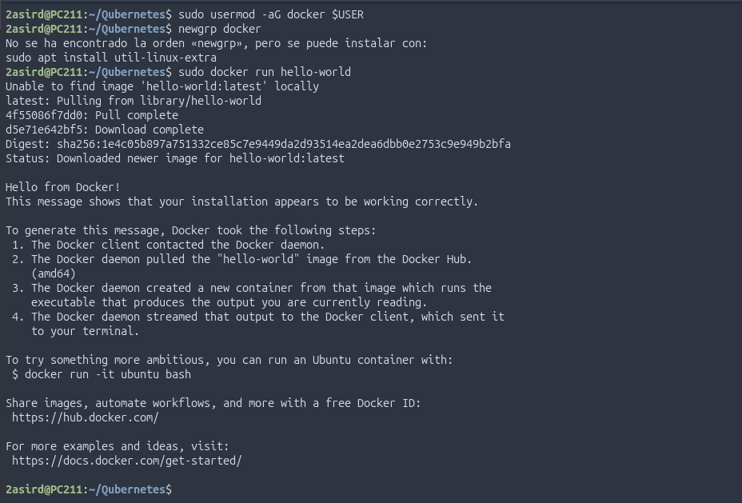

# Docker - Configuración de permisos y prueba inicial

Documentación de los comandos ejecutados para configurar el grupo de Docker y comprobar el funcionamiento del motor de contenedores, con su explicación y captura.

---

## Configuración de usuario y contenedor de prueba

```bash
sudo usermod -aG docker $USER
newgrp docker
sudo docker run hello-world
```

**Explicación:**
- `sudo usermod -aG docker $USER`: Añade el usuario actual (`$USER`) al grupo `docker` (`-aG` agrega el grupo sin eliminar los grupos a los que ya pertenece) para poder ejecutar comandos de Docker sin `sudo` tras reiniciar la sesión.
- `newgrp docker`: Intenta activar el nuevo grupo en la sesión actual sin cerrar sesión (en el sistema indica que el comando `newgrp` no está instalado y sugiere `sudo apt install util-linux-extra`).
- `sudo docker run hello-world`: Descarga la imagen `hello-world:latest` desde Docker Hub si no está en local y crea un contenedor de prueba que imprime el mensaje `Hello from Docker!`, confirmando que el demonio de Docker funciona correctamente.


